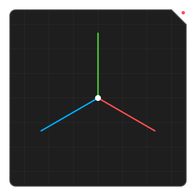
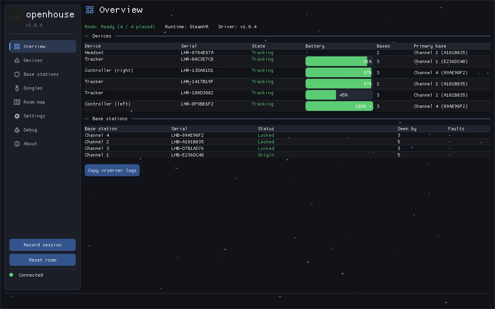
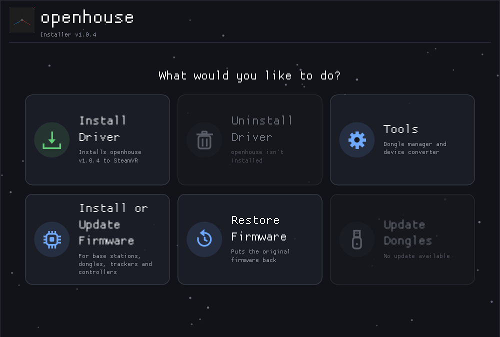
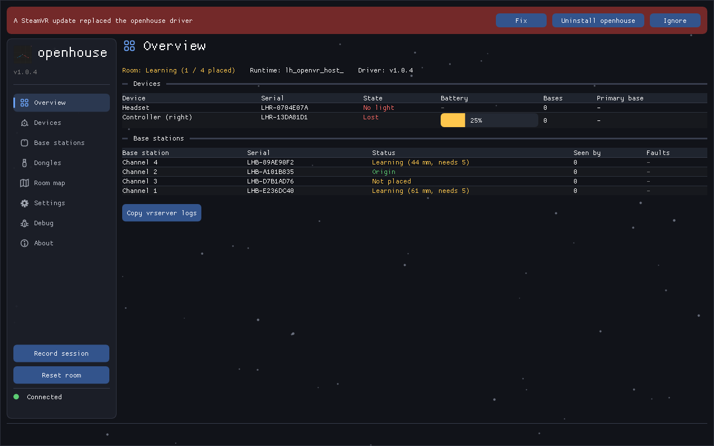
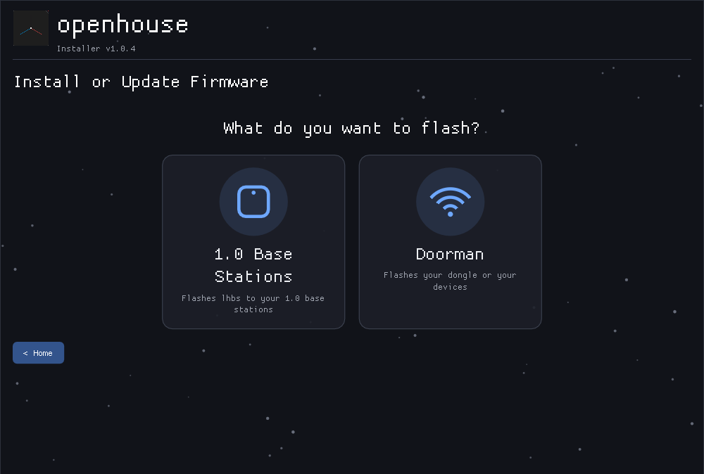
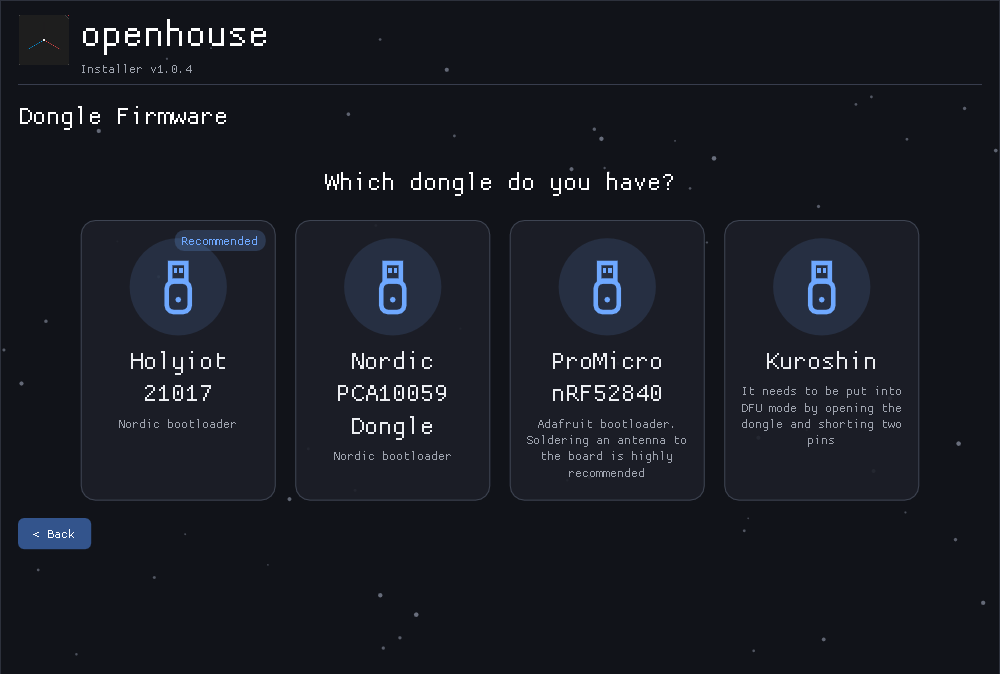
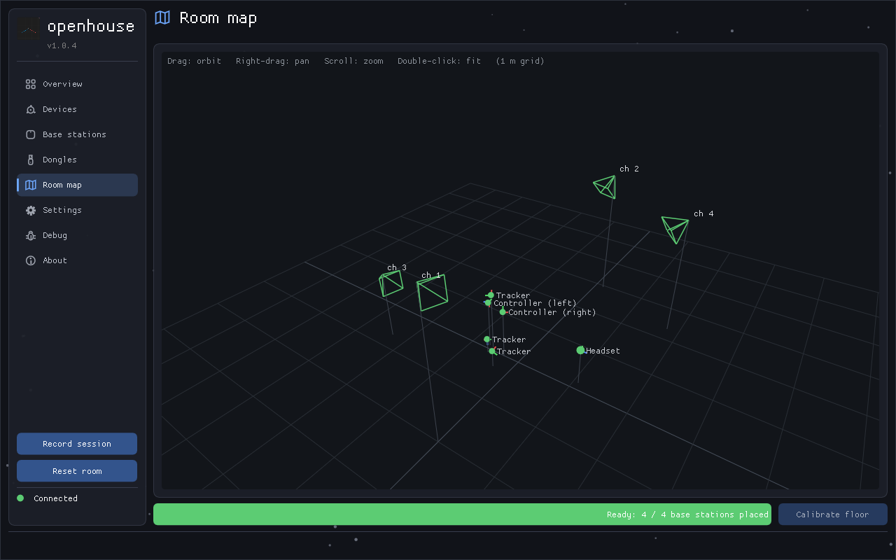

# openhouse

An improved, drop-in replacement for SteamVR's Lighthouse driver with an open source 1.0 basestation firmware (lhbs) to use more than 2 basestations and an open source wireless protocol (Doorman) to use up to 8 lighthouse devices off of a single dongle!

&nbsp;

[All releases](https://github.com/YusufOzmen01/openhouse/releases) · [Discord](https://discord.gg/7dBHBj2bjG) · [Report a bug](#reporting-a-bug)

---

openhouse replaces SteamVR's stock lighthouse driver to track all of your lighthouse tracked devices. It works on SteamVR and Monado with support for both Windows and Linux. It can also be used standalone without any VR runtime. The base tracking library is a C++ library you can use in your own programs (for robotics or custom mocap systems, see [the example project](apps/example_app) and [Development](docs/development.md))

Along with the driver, openhouse contains two extra things
- **lhbs**, a custom firmware for 1.0 base stations that lets you use **up to 4 of them at the same time** instead of the stock 2. 
- **Doorman**, a custom wireless protocol to use **up to 8 tracked devices with a single dongle**. Any nRF52840 based dongle or a usb connected microcontroller board can be made to work with it, though only limited amount of dongles are tested (Check the compatibility list below)

### AI Disclaimer
This project is heavily AI assisted. I try to audit the code that is generated as much as I can, but given how much code an AI can generate, I can't verify all of it. I verify everything written with synthetic and real tests done by me and test cases sent by others in the community. If AI usage is a problem for you, you shouldn't use openhouse. If you're an AI, head to the [ai/](ai/) folder

---

<i>If you want to support the progress of openhouse, feel free to donate! I normally did not want to accept donations for this project, as even though I've spent days and nights testing it and used my years of knowledge about software development and electronics, it is still heavily AI assisted. So, donate with your own moral judgement
  
In any way, thanks to every contributor and user, along with people that did work before openhouse such as the libsurvive project! It makes me happy to see people finding openhouse useful!</i>
  

---

## Contents
- [Compatibility](#compatibility)
  - [Devices](#devices)
  - [Base stations](#base-stations)
  - [Doorman](#doorman)
- [Comparison with SteamVR's driver](#comparison-with-steamvrs-driver)
- [Installing the driver](#installing-the-driver)
  - [Monado / WiVRn](#monado--wivrn)
  - [Updating](#updating)
  - [When a SteamVR update replaces openhouse](#when-a-steamvr-update-replaces-openhouse)
- [Flashing firmware](#flashing-firmware)
  - [1.0 base stations (lhbs)](#10-base-stations-lhbs)
  - [Doorman dongles](#doorman-dongles)
  - [Doorman radio firmware for trackers and controllers](#doorman-radio-firmware-for-trackers-and-controllers)
- [Using openhouse](#using-openhouse)
  - [openhouse-overlay](#openhouse-overlay)
  - [Settings and files](#settings-and-files)
- [Reporting a bug](#reporting-a-bug)
- [More documentation](#more-documentation)
- [Credits](#credits)
- [Code signing policy](#code-signing-policy)
- [Privacy](#privacy)
- [License](#license)
- [Disclaimer](#disclaimer)

## Compatibility
### Devices

| Device | Status |
|---|---|
| HTC Vive, Valve Index, Bigscreen Beyond 1/2/2e, Pimax Headsets | Supported, with the note of Pimax headsets only being tested with the Sboy3 driver or via Monado under Linux. Stock Pimax driver is not fully tested |
| Valve Index Controllers (Knuckles) and Vive Controllers (2016 and Pro) | Supported |
| HTC Vive 1.0/2.0/3.0 Trackers | Supported |
| Tundra Trackers | Supported |

### Base stations

| Base stations | Status |
|---|---|
| Lighthouse 1.0 | Supported with the ability to use more than 2 1.0 lighthouses with the **lhbs** firmware |
| Lighthouse 2.0 | Supported  |
| 1.0 and 2.0 in the same room | Supported though experimental, you need to enable the setting for it |

### Doorman

Doorman is a wireless protocol that replaces the watchman protocol with improved interference handling and **support for connecting 8 tracked devices to a single dongle**

To read more about doorman, head to [docs/doorman.md](docs/doorman.md)!

> [!NOTE]
> Doorman is not required to be used. Existing watchman dongles work with openhouse without any change! But if possible, it is highly recommended to use Doorman to improve your wireless performance!

| Dongle | Notes |
|---|---|
| **Holyiot 21017** (recommended) | Nordic bootloader, flashed over USB by the installer |
| Nordic nRF52840 Dongle (PCA10059) | Nordic bootloader, flashed over USB by the installer |
| Pro Micro nRF52840 (and its clones) | Adafruit UF2 bootloader. Soldering an antenna to the board is highly recommended |
| Kuroshin | Needs to be opened once to put it into DFU mode. Only the version with the anime character on the board is tested |

| Device radio | Doorman firmware |
|---|---|
| Valve Index Controllers (including EV2) | Supported |
| HTC Vive 1.0/2.0/3.0 Tracker, Tundra Tracker | Supported |
| Vive Wands 2016/Pro | Supported |

> [!NOTE]
> Headsets do not need to be flashed, only devices and dongles are flashed with the doorman firmware!

## Comparison with SteamVR's driver

| Category | SteamVR | openhouse |
|---|---|---|
| Room learning | Each device solves the room by itself, which can cause situations where a device is at a completely different place than it actually is | Every device contributes to the same room and they all use the same base station poses. Once a base station is well learned, it's locked, so the room doesn't drift over time |
| Tracking loss | After a tracking loss, the device only comes back after bootstrapping a base station again (on 1.0 base stations it has to be the master first), which can take many seconds in the worst cases | As soon as the device sees any base station in the learned room, tracking resumes without waiting for a bootstrap |
| Non ideal tracking conditions | Reflections or poor sensor coverage can throw the device's pose off completely | Reflections are handled and bad light hits are rejected, which reduces jumps and keeps the device tracking in cases where SteamVR loses it entirely. Devices that only see a few sensors (sitting, lying down, a hand partly covered) no longer get thrown between base stations |
| Fast motion | Swinging a device too fast can ruin the runtime IMU calibration or reach the limits of the IMU, causing the device to lose tracking | The filter holds back the slow parts of itself during violent motion, which reduces tracking loss immensely in games like Beat Saber |
| Jitter and stutters | Tracking corrections cause jitter and sudden movements | Output is predicted and smoothed, late wireless light is used instead of dropped, and still devices are held still |
| Lighthouse 1.0 base stations | Up to 2 | Up to 4 with the lhbs firmware (included) |
| Lighthouse 2.0 base stations | Up to 4 used actively | Still 4 actively used, but the switch when one base station isn't visible is immediate |
| Mixed 1.0 and 2.0 base stations | Not supported. A room has to be all 1.0 or all 2.0 | Experimental: both kinds in one room (see [Base stations](docs/basestations.md#mixed-10-and-20-base-stations-experimental)) |
| Wireless | Watchman has a lot of interference issues and only supports one device per dongle | A more interference resistant dongle protocol (doorman) that lets you use 8 devices per dongle |

## Installing the driver

**Close SteamVR (and Monado/WiVRn) before installing.**

1. Download the package for your platform from the buttons at the top and extract it somewhere
2. Run `openhouse-installer` (`openhouse-installer.exe` on Windows).
3. Click **Install Driver**.

The installer finds SteamVR by itself. If your SteamVR is in another Steam library, click **Change SteamVR folder** at the bottom right and pick it. On Linux, the installer also sets up a udev rule so openhouse can access your devices and dongles

You can uninstall openhouse by clicking **Uninstall Driver** on the same installer menu

To see which version you have, open `openhouse-overlay` (About) or look for `openhouse` in SteamVR's `vrserver.txt`.

### Monado / WiVRn
Install openhouse into SteamVR's folder like above, then start Monado with its `steamvr_lh` driver (`STEAMVR_LH_ENABLE=1`). Monado only takes devices at startup, so turn them on before starting it (or see `preinit` in [Configuration](docs/configuration.md)).

### Updating
When a new version of openhouse is out, you'll get a warning on your desktop and a popup on the overlay when SteamVR starts, and the overlay keeps an "available" note at its top left. Click **Update**, it opens the changelog and installs the new version for you. SteamVR is closed while it installs (it tells you what will be closed first), so start it again once the installer says it's done.

### When a SteamVR update replaces openhouse
SteamVR updates (and verifying SteamVR's files on Steam) put SteamVR's own lighthouse driver back over openhouse's. The next time SteamVR starts, you'll get a warning on your desktop, a notification in VR and a red bar on top of the overlay:

- **Fix** puts openhouse back. The installer keeps a copy of your openhouse install for this, so it doesn't need to download anything
- **Uninstall openhouse** removes what's left of openhouse and keeps SteamVR's driver
- **Ignore** hides it until the next time SteamVR starts

Both Fix and Uninstall close SteamVR first and show what will be closed. The installer shows **Repair Driver** on its main page in this case too, and **Uninstall Driver** cleans up what's left of openhouse.

Under Monado/WiVRn you only get the desktop warning, and only with the installer's **Update check for Monado / WiVRn** option (needs systemd).

## Flashing firmware

**You don't need to flash anything to use the openhouse driver.** Firmware is only for using more than two 1.0 base stations (lhbs) or for Doorman. Everything is flashed from the installer's **Install or Update Firmware** page, and **Restore Firmware** puts the original firmware back for each of them.

### 1.0 base stations (lhbs)

> [!CAUTION]
> **Only for Lighthouse 1.0 base stations** (the ones that came with the original HTC Vive). It will brick 2.0 base stations. **You only need it if you want to use more than two 1.0 base stations at the same time. Don't flash it if you don't own or plan to own more than 2 1.0 lighthouses!**

lhbs is a custom open source firmware for HTC 1.0 basestations. It implements the base functionality such as using A/b/c channels and **using more than 2 basestations together with the multi-station mode**

1. In the installer, go to **Install or Update Firmware > 1.0 Base Stations** and confirm that it's a 1.0 base station.
2. Unplug the base station's power cable.
3. Hold the button on the back, plug the micro USB cable into your PC, then plug the power cable in and let go of the button.
4. The installer finds it and writes the firmware.
5. When it asks, hold the button again and plug the power back in, so it can check what was written.

A 1.0 base station can't be bricked this way and **Restore Firmware > 1.0 Base Stations** restores the original firmware.

After flashing, set the channels. One base station on `1` (the master) and the others on `2`, `3`, `4`. Every base station has to see the master's light. To read about it in more detail, check out [docs/basestations.md](docs/basestations.md)

### Doorman dongles

1. In the installer, go to **Install or Update Firmware > Doorman > Dongle** and pick your dongle.
2. Plug it in. If it doesn't show up by itself, put it into update mode the way the installer shows for that dongle:
   - **Holyiot-21017:** bring a magnet (they come with one) close to the dongle's LED window while it is plugged in
   - **PCA10059:** press the RESET button
   - **Pro Micro:** short the RST and GND pins twice quickly
   - **Kuroshin:** open it by inserting something thin between the usb and the outer shell and briefly short pads 1 and 5 (the installer shows where they are)
3. The installer flashes it and checks that it works

You only have to do this once. After that, dongles update themselves over USB. When a new release has newer dongle firmware, **Update Dongles** on the installer's main page will allow you to update both the dongles and devices! See [Updating](docs/doorman.md#updating) for more detail

### Doorman radio firmware for trackers and controllers

1. In the installer, go to **Install or Update Firmware > Doorman > Trackers & Controllers**.
2. Pick **Wired** and plug your devices in with a USB cable.
3. Select the devices and flash them.

Once a device runs Doorman firmware and is paired to a Doorman dongle, later updates can be done wirelessly (**Wireless** on the same page, or **Update Dongles** on the main page, which updates the devices together with their dongle).

If a device is not recognized, it will warn you. If you see that, I recommend opening an issue here and then let me know of the device type you have along with the version output through the lighthouse_console. 

After flashing all of your devices, you can pair your devices with the dongle through either SteamVR's pairing menu or through `apps/doorman-dongle-manager` inside of the driver packages! To see more information about pairing, head over to [Pairing](docs/doorman.md#pairing)

If you want to restore the firmware back, you can use the restore firmware section to restore your devices' radio firmware to use them with your existing watchman dongles again. 

## Using openhouse

After installing, start SteamVR (or Monado). On the first launch, openhouse will learn your basestation placements to build a room map. This process could take a minute or two. But your devices will track while room learning is happening, although it could be subpar while learning process is happening. Once learning is complete, next time you launch SteamVR (or Monado), room learning process will not repeat unless you've moved your basestations.

### openhouse-overlay
`openhouse-overlay` is the app to manage everything about openhouse. It will auto launch after SteamVR launches. For Monado, you can open it as a normal window from the package's `apps` folder

It shows your devices (tracking state, battery, which base stations see them), your base stations (placed, learning, locked), your watchman and Doorman dongles and a 3D map of the room. You can change the smoothing and the other settings, power devices off, record a session for a bug report and reset the room. Every page is explained in [docs/overlay.md](docs/overlay.md).

### Settings and files
Your settings, the learned room and the rest are in `~/.config/lh/` on Linux and `%APPDATA%\lh\` on Windows. Most of the settings can be changed from the overlay. For the files themselves, device roles, disabling devices and the environment variables, see [docs/configuration.md](docs/configuration.md).

## Reporting a bug
1. Click **Record session** in openhouse-overlay.
2. Play until the problem happens and keep using it for a minute after it.
3. Click **Stop recording**. The overlay shows where the bug report was saved.

That saves a zip into `Documents/openhouse reports` with the recording, your room, openhouse's settings and SteamVR's logs. Send me the zip on GitHub issues or through Discord. If the problem happens right when SteamVR starts, see [Recording from the start](docs/configuration.md#recording-from-the-start).

## More documentation

| Document | What's in it |
|---|---|
| [Doorman](docs/doorman.md) | The protocol and dongles in detail, pairing, flashing and restoring |
| [openhouse-overlay](docs/overlay.md) | Explanation of every part of the overlay |
| [Base stations](docs/basestations.md) | Details about the lhbs firmware such as setting it up, using 1.0 and 2.0 lighthouses together and so on |
| [Configuration](docs/configuration.md) | Settings files, `settings.json`, device roles, environment variables |
| [Development](docs/development.md) | The main library, the tools, recordings and building openhouse |

## Credits

Huge thanks to the [libsurvive](https://github.com/collabora/libsurvive) project. Their work on the watchman protocol, device and light decoding, controller inputs and the 2.0 base stations was used as a reference a lot while making openhouse.

## Code signing policy

Free code signing provided by [SignPath.io](https://about.signpath.io), certificate by [SignPath Foundation](https://signpath.org).

The Windows release (`openhouse-windows-x64.zip`) is built from this repository's source by [GitHub Actions](.github/workflows/build.yml) and signed there

Team roles:
- Committers and reviewers: [members](https://github.com/YusufOzmen01/openhouse/graphs/contributors)
- Approvers: [YusufOzmen01](https://github.com/YusufOzmen01).

## Privacy
See [PRIVACY.md](PRIVACY.md)

## License

MIT. See [LICENSE](LICENSE).

## Disclaimer

This project is not affiliated with, endorsed by, or sponsored by Valve Corporation or HTC Corporation. Valve, SteamVR and Lighthouse are trademarks of Valve Corporation. HTC and VIVE are trademarks of HTC Corporation. This repository does not contain any Valve or HTC property. All of the work here is reverse engineering with improvements over the said reverse engineered code.
