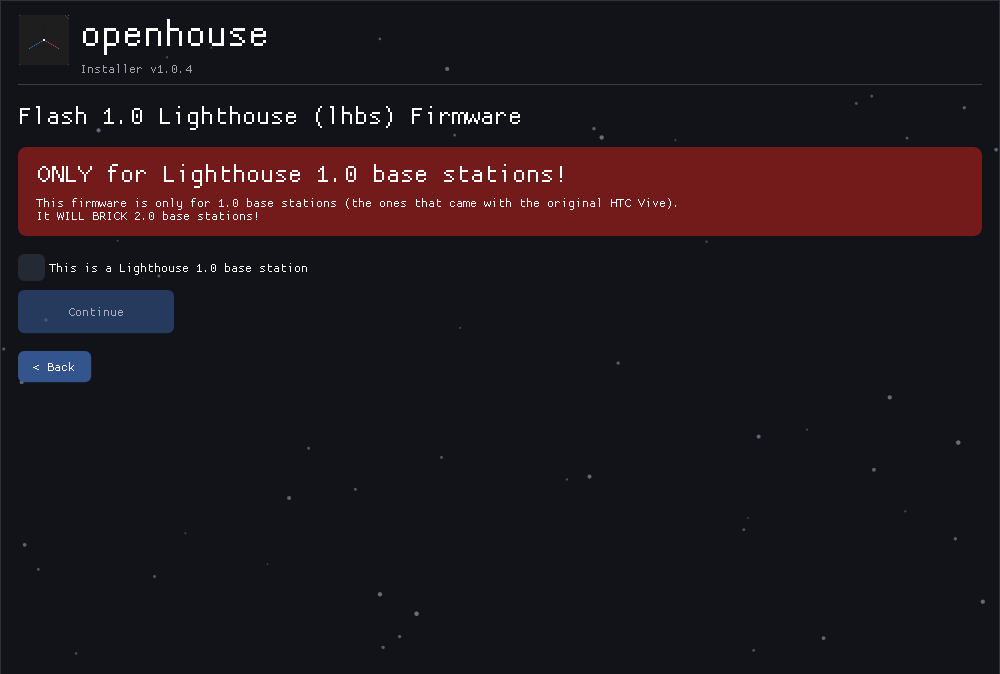

# Base stations

[Back to the README](../README.md)

- [lhbs: up to 4 Lighthouse 1.0 base stations](#lhbs-up-to-4-lighthouse-10-base-stations)
  - [Flashing](#flashing)
  - [Setting the channels](#setting-the-channels)
- [Mixed 1.0 and 2.0 base stations (experimental)](#mixed-10-and-20-base-stations-experimental)

## lhbs: up to 4 Lighthouse 1.0 base stations

> [!CAUTION]
> **Only for Lighthouse 1.0 base stations** (the ones that came with the original HTC Vive). It will brick 2.0 base stations.

lhbs is a custom open source firmware for HTC 1.0 basestations. It implements the base functionality such as using A/b/c channels and **using more than 2 basestations together with the multi-station mode**

### Flashing

1. In the installer, go to **Install or Update Firmware > 1.0 Base Stations** and confirm that it's a 1.0 base station.
2. Unplug the base station's power cable.
3. Hold the button on the back, plug the micro USB cable into your PC, then plug the power cable in and let go of the button.
4. The installer finds it and writes the firmware.
5. When it asks, hold the button again and plug the power back in, so it can check what was written.

A 1.0 base station can't be bricked this way and **Restore Firmware > 1.0 Base Stations** restores the original firmware.

### Setting the channels
Press the button on the back of the base station to change its channel. With lhbs, it goes `A` -> `b` -> `c` -> `1` -> `2` -> `3` -> `4` and back to `A`. The channel is saved, so you only need to do this once.

- `A`, `b` and `c` are the normal channels and work exactly like the stock firmware (for 1 or 2 base stations).
- `1` to `4` are the multi-station channels, for 2 to 4 base stations:
  - Set **one** base station to `1`. This is the master.
  - Give every other base station a different number (`2`, `3`, `4`). Two base stations on the same number won't work.
  - Every base station has to see the master's light, since that's how they stay in sync (sync cables don't work in this mode).
  - You don't have to use every number. For 3 base stations, `1` `2` `3` is fine, and they share the sweeps between the 3 of them automatically.
- Don't mix the normal and the multi-station channels in one room. Either all of them are on `A`/`b`/`c`, or all of them are on `1`-`4`.

openhouse detects the multi-station mode by itself, nothing needs to be set in the driver. The stock SteamVR driver can't use the multi-station channels, so switch back to `A`/`b`/`c` if you go back to it.

## Mixed 1.0 and 2.0 base stations (experimental)

openhouse can use HTC Vive 1.0 and 2.0 base stations together in one room, which SteamVR can't. Turn it on with **Mixed basestations > Enabled** in openhouse-overlay's Settings, or `"mixedLight": true` in `settings.json`. Things to know:

- **Devices that don't work with 2.0 base stations can't be used.** That includes the original HTC Vive headset, the Vive wands and the 2017 Vive trackers (the ones with a grey power button instead of a blue one).
- **The headset stays in 2.0 mode at all times.** It times the 2.0 base stations for the other devices (the **Headset times the 2.0 stations** toggle), so controllers and trackers have to switch less often. Turning that toggle off makes the headset blank the view every time a switch happens.
- **The headset also measures the 2.0 base stations' timing for the other devices** (the **Rotor reference** toggle, on by default). A 2.0 base station's rotor doesn't spin perfectly evenly, and in mixed mode that shows up as a small wobble on controllers and trackers. The headset sees the real timing, so the others take that wobble off while the headset can see the same base station.
- **1.0 as fallback only** is a test, off by default: devices stay on 2.0 light while they can, which is steadier, and only read the 1.0 base stations when the 2.0 ones don't cover them.
- **Controllers and trackers can be turned off separately** for this mode, so you can only use it on the kind of device you want.
- **The first few minutes might be a bit rough**, as openhouse has to work out whether you're in a mixed room at all.
- **It takes longer to settle.** Learning the room takes a bit more time than with one kind of base station. That's normal, give it some time.
- If you run into a problem with the room or tracking, click **Reset room** in openhouse-overlay, or delete `roommap.json` ([Configuration](configuration.md#files)).
