# Doorman

[Back to the README](../README.md)

Doorman is openhouse's own wireless system. Instead of one Valve/HTC Watchman dongle per device, a Doorman dongle carries **up to 8 devices**, and it's a cheap off-the-shelf nRF52840 board. It has two parts:
- **The dongle firmware**, flashed onto one of the supported nRF52840 dongles
- **The radio firmware**, flashed onto the radio chip inside your trackers and controllers

Compared to Watchman, Doorman hops between channels and skips the ones that are noisy, so a busy 2.4 GHz environment (WiFi, other dongles, other people's devices) causes a lot fewer dropouts. You can see the signal and the loss of every device in the [dongle manager](#the-dongle-manager)

Doorman is completely optional. Valve and HTC dongles keep working the same way, and you can use both at the same time (some devices on Watchman dongles, others on a Doorman dongle). Doorman only works with the openhouse driver, so if you go back to SteamVR's driver, restore the original radio firmware first ([Restoring](#restoring)).

- [Doorman](#doorman)
  - [Supported hardware](#supported-hardware)
    - [Dongles](#dongles)
    - [Devices](#devices)
  - [Flashing a dongle](#flashing-a-dongle)
    - [Kuroshin](#kuroshin)
  - [Flashing your devices](#flashing-your-devices)
  - [Pairing](#pairing)
  - [The dongle manager](#the-dongle-manager)
  - [Updating](#updating)
  - [Restoring](#restoring)
  - [Troubleshooting](#troubleshooting)

## Supported hardware

### Dongles

| Dongle | Bootloader | How it gets into update mode | Notes |
|---|---|---|---|
| **Holyiot 21017** | Nordic | Bring a magnet (it comes with one) close to its LED window while it's plugged in | Recommended. Small, has a proper antenna and is the most tested |
| Nordic nRF52840 Dongle (PCA10059) | Nordic | Press its RESET button | Nordic's own dongle |
| Pro Micro nRF52840 (nice!nano and clones) | Adafruit UF2 | Short RST and GND twice quickly | The PCB antenna is weak. Soldering an antenna to the board is highly recommended |
| Kuroshin | Nordic | Open it and briefly short pads 1 and 5 | Only the version with the anime character on the board is tested |

Update mode is only needed the first time (or to rescue a dongle). After that, the dongle updates itself over USB ([Updating](#updating)).

### Devices

| Device | Radio | Doorman firmware |
|---|---|---|
| Valve Index controllers (every revision, including EV2) | nRF52 | Supported |
| Vive Tracker (2018) | nRF52 | Supported |
| Vive Tracker 3.0 | nRF52 | Supported |
| Tundra Tracker | nRF52 | Supported |
| Vive Tracker 1.0 (2017) | nRF51 | Supported |
| Vive controllers (wands) | nRF51 | Supported |
| Headsets | - | Not supported. They're connected by cable anyway |

The installer reads each device's hardware id and picks the right image. A device it has never seen isn't flashed unless you confirm it.

## Flashing a dongle

1. Open `openhouse-installer` and go to **Install or Update Firmware > Doorman > Dongle**.
2. Pick your dongle.
3. Plug it in. If it doesn't show up by itself, put it into update mode as shown in the table above.
4. The installer writes the firmware and checks that the dongle answers.

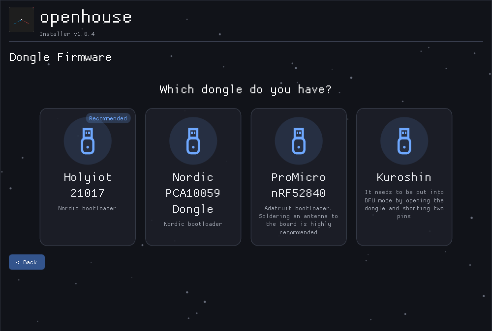

On Linux, the installer sets up the udev rule that lets openhouse talk to the dongle. If you see "Needs the openhouse udev rule", run the installer once.

### Holyiot 21017

Bring a magnet close to the thin LED window near the USB plug while it's plugged in. The dongle comes with one.

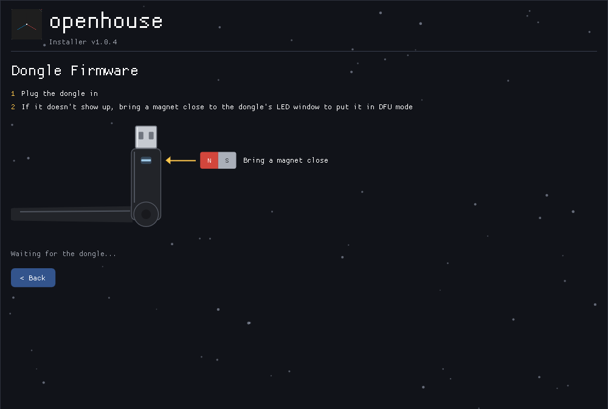

### Nordic nRF52840 Dongle (PCA10059)

Press the RESET button, the square one at the end of the board next to the round white one.

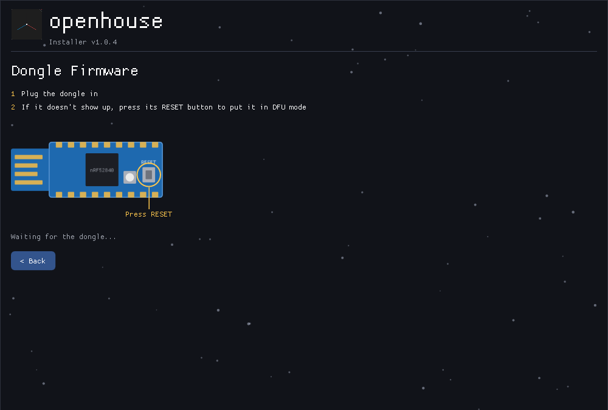

### Pro Micro nRF52840

Short the RST and GND pins (third and fourth on the right, with the USB port at the top) twice quickly. Once only restarts it.

The board's own antenna doesn't reach far. Soldering a 31.2 mm wire to the end of the ceramic antenna at the bottom right is optional, but highly recommended.

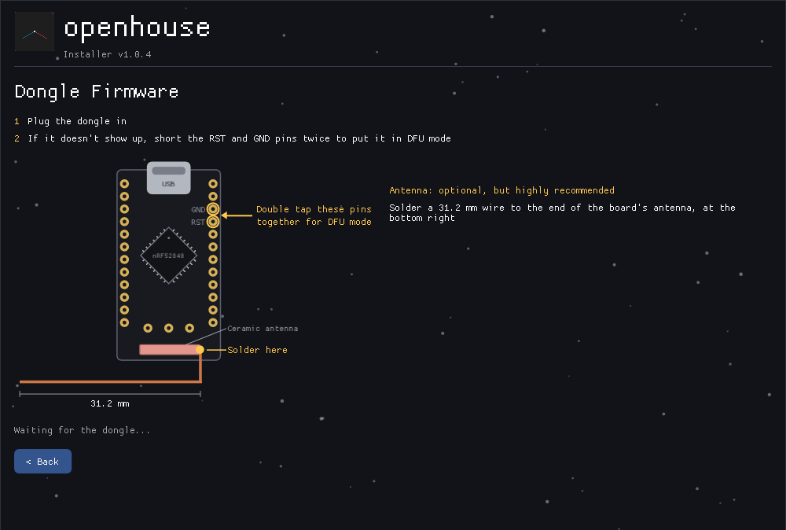

### Kuroshin

The Kuroshin has no button, so it has to be opened once. With the chip side up and the USB plug at the bottom, pads 1 and 5 are the first and the last of the row above the chip. Touch them together for a moment with tweezers or a wire, and the dongle shows up in update mode.

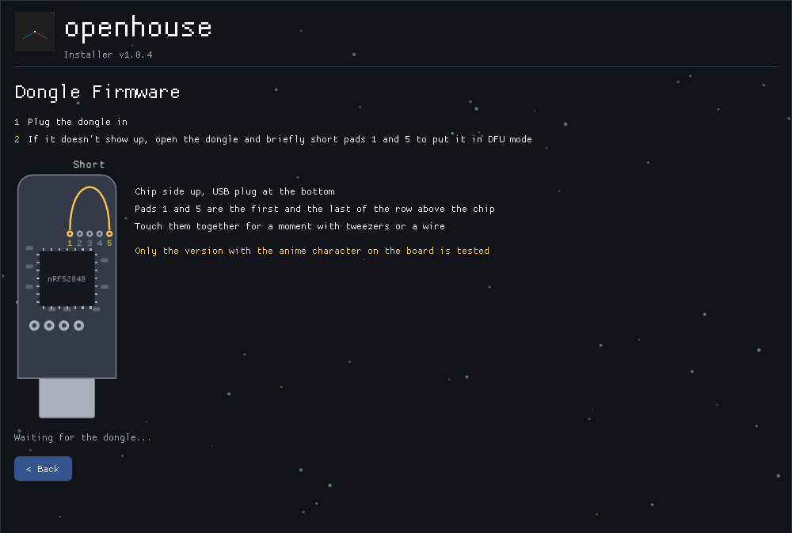

## Flashing your devices

Go to **Install or Update Firmware > Doorman > Trackers & Controllers**.

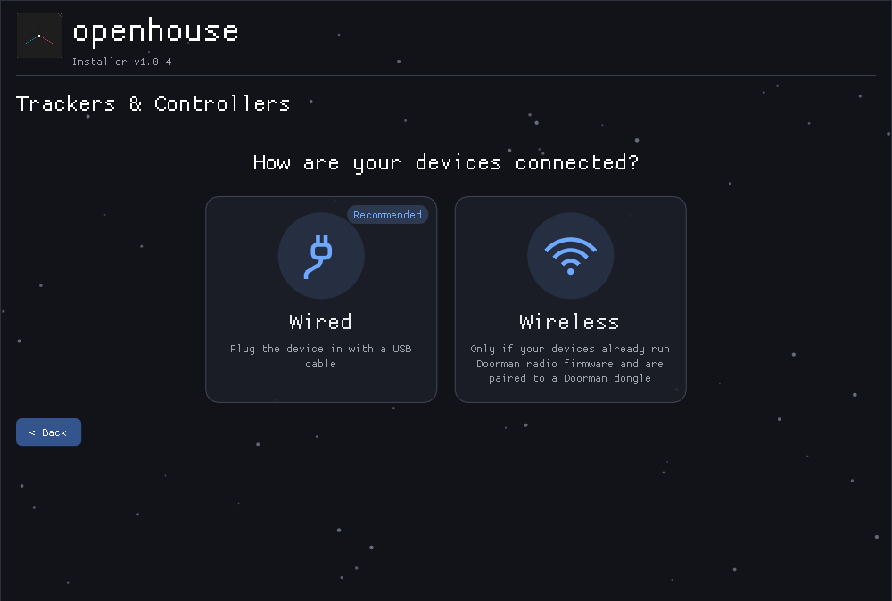

- **Wired** (recommended, and the only way for the first time): plug your devices in with a USB cable, select them and flash. SteamVR's own update tool is used to write the image, so SteamVR has to be installed.
- **Wireless**: for devices that already run Doorman firmware and are paired to a Doorman dongle. Turn them on and flash them without a cable.

After a wireless flash, the device turns off. It installs the new firmware the next time you turn it on.

## Pairing

A Doorman dongle has 8 slots, one device each. You can pair in three ways:
- **SteamVR's pairing menu** (Devices > Pair Controller) works while the openhouse driver is running
- **The dongle manager**: click **Pair a device**, or **Pair to this slot** on a slot to replace the device in it
- **`lighthouse_console`'s `pair` command** works too

Then put the device into pairing mode the usual way (hold the system/power button until the LED blinks blue). Devices without working buttons can still be paired from the dongle manager.

Pairing a device that is also plugged in by USB is fine: openhouse uses the cable while it's plugged in, and the radio when it isn't.

## The dongle manager

`doorman-dongle-manager` is in the package's `apps` folder, and the installer opens it from **Tools > Dongle Manager**. It works with or without the driver running.

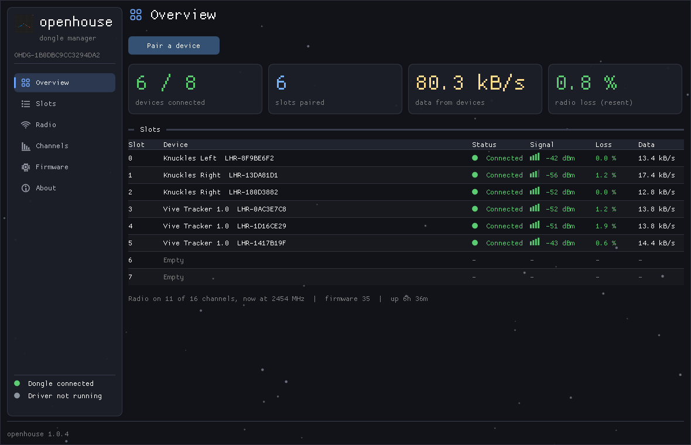

- **Overview**: how many devices are connected, which slots are paired, the data rate and the radio loss, with a row per slot
- **Slots**: a card per slot. Pair to a slot, identify the device in it (read its name), or unpair it. **Unpair all** clears every slot, and every device then has to be paired again

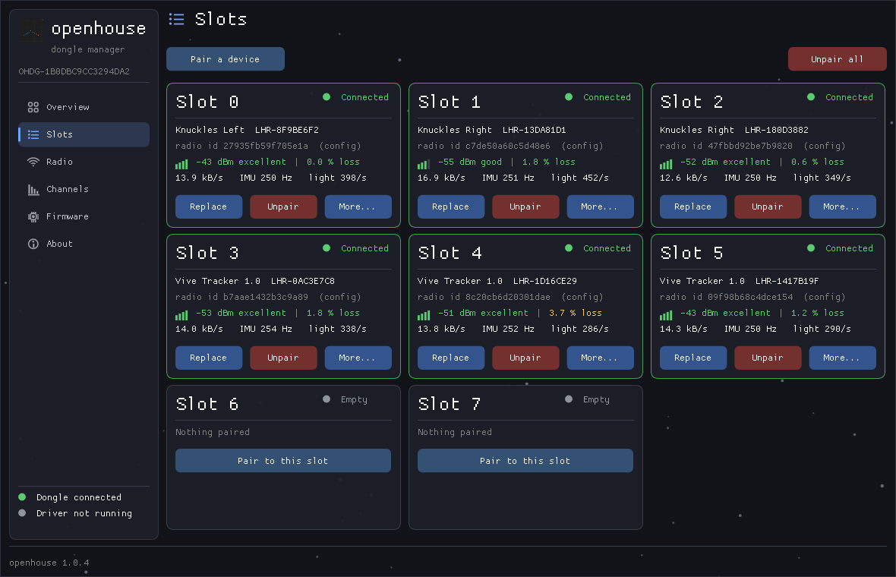

- **Radio**: the radio's counters. Corrupted answers, polls the device missed and frames dropped on either side, per device. Useful when a device drops out

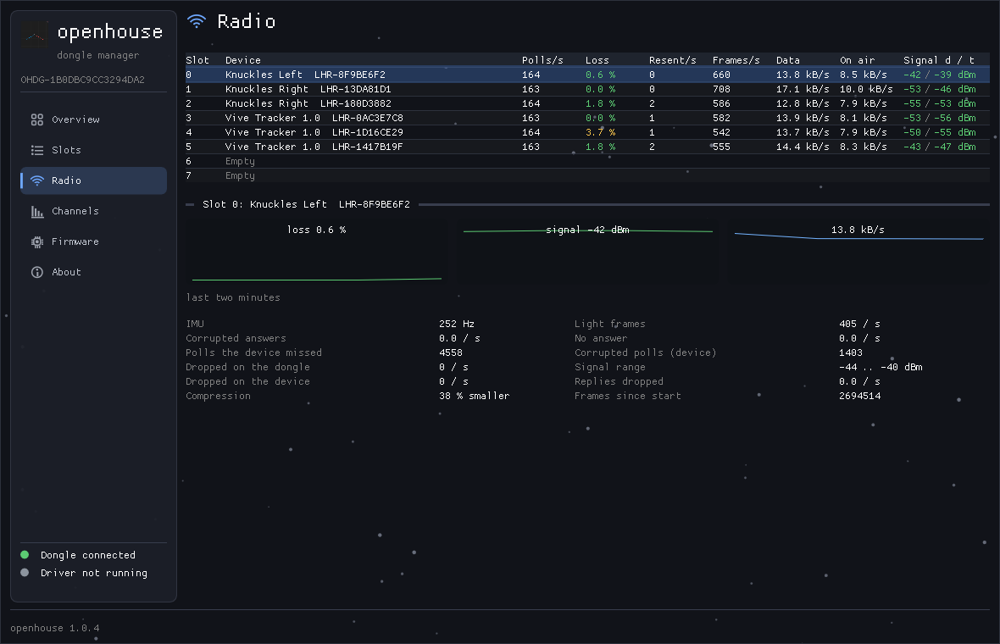

- **Channels**: loss per channel. The dongle skips bad channels for a while (shown grey), the blue ones are in use

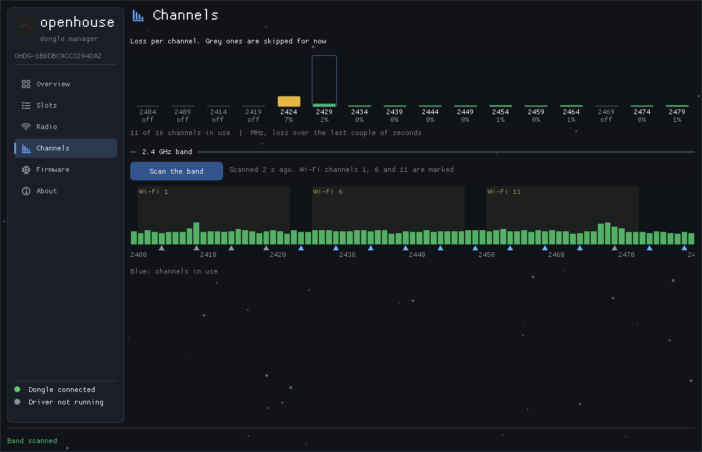

- **Firmware**: the dongle's firmware version and bank, and a manual update from a file. Normally you don't need it, the installer updates dongles for you
- **About**: the version

If you have more than one dongle, pick it at the top left.

## Updating

When a release has newer Doorman firmware, **Update Dongles** on the installer's main page lights up (it's greyed out when everything is up to date).

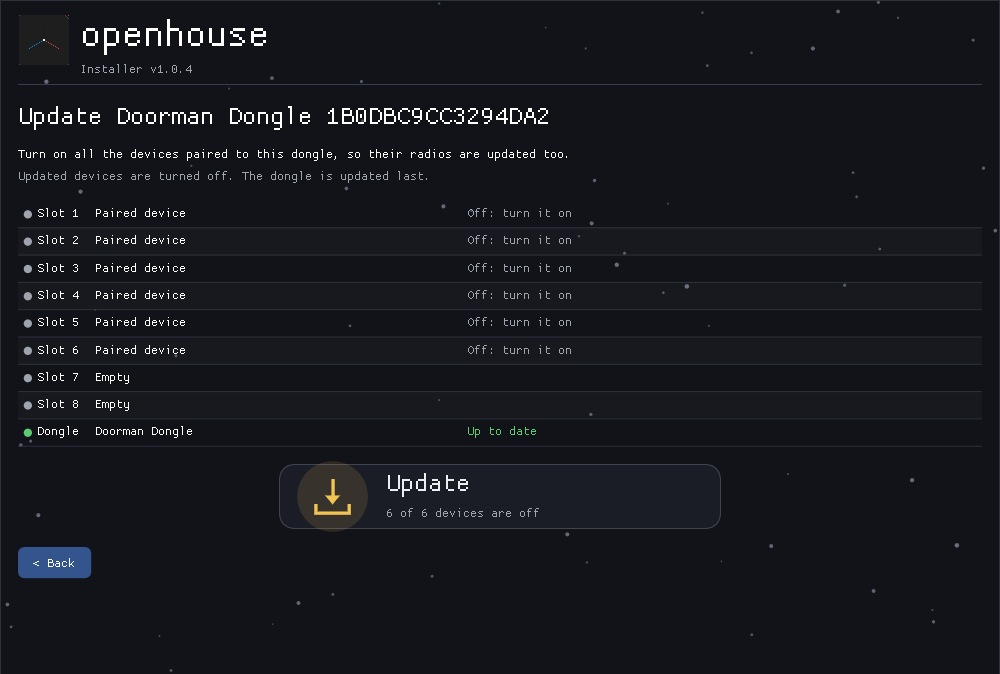

1. Pick the dongle if you have more than one.
2. The page shows all 8 slots. **Turn on every device paired to that dongle**, so their radios are updated too. Green means up to date, yellow means it needs an update.
3. Click **Update**. If every device is on, it starts by itself.

The devices are updated first and the dongle last, since an updated dongle needs updated devices. Each updated device is turned off. A device that fails is retried a few times. If it still fails, plug it in with a cable and flash it from **Install or Update Firmware** (Wired).

Turning on all the devices is recommended. A device that was off during the update keeps its old firmware, so if it doesn't connect afterwards, update it through a cable.

Dongles keep two copies of their firmware and switch to the new one only after it has been fully written and checked, so an interrupted update doesn't break the dongle.

## Restoring

**Restore Firmware > Trackers & Controllers** puts the original radio firmware back (taken from your SteamVR installation), through a cable. Do this before going back to SteamVR's own driver. The devices then pair to Valve/HTC dongles like before.

A dongle doesn't need to be restored, it's a separate board. To use it for something else, flash it through its bootloader.

## Troubleshooting

- **The dongle doesn't show up in update mode**: try another USB port or cable, and for the Pro Micro, short RST and GND twice quickly (once only restarts it)
- **A device keeps dropping**: check the Radio and Channels pages of the dongle manager. Keep the dongle in sight of your play space, a USB extension cable helps a lot
- **A device doesn't connect after an update**: plug it in with a cable and flash it with **Wired**
- **SteamVR's pairing menu doesn't find the device**: make sure the openhouse driver is installed. Pairing through SteamVR only works with it
