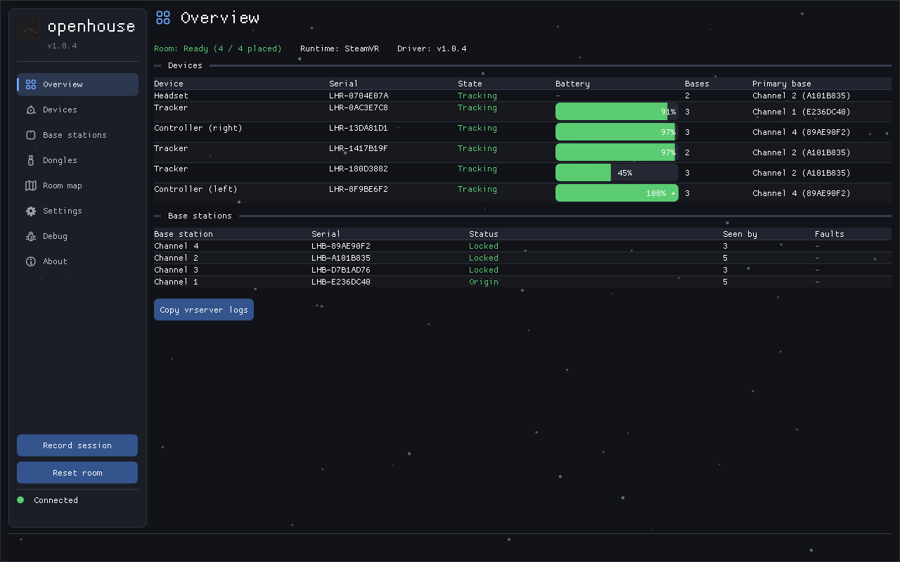
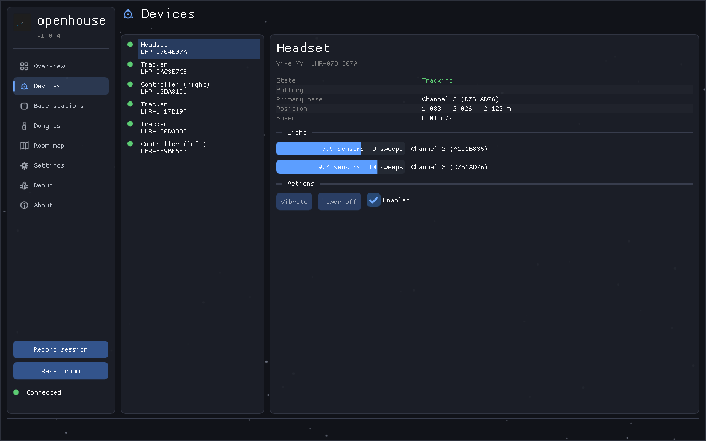
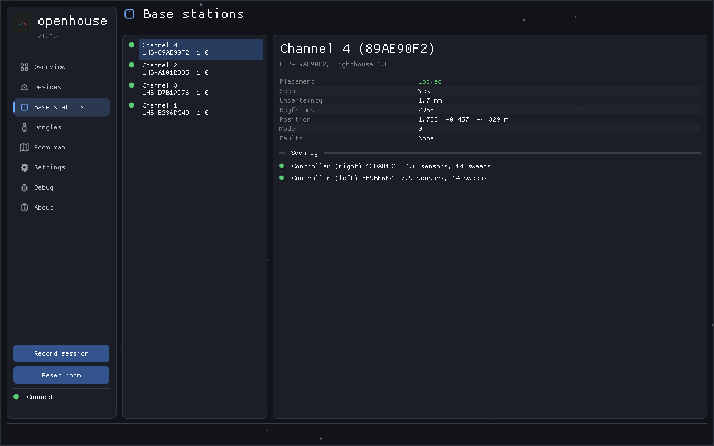
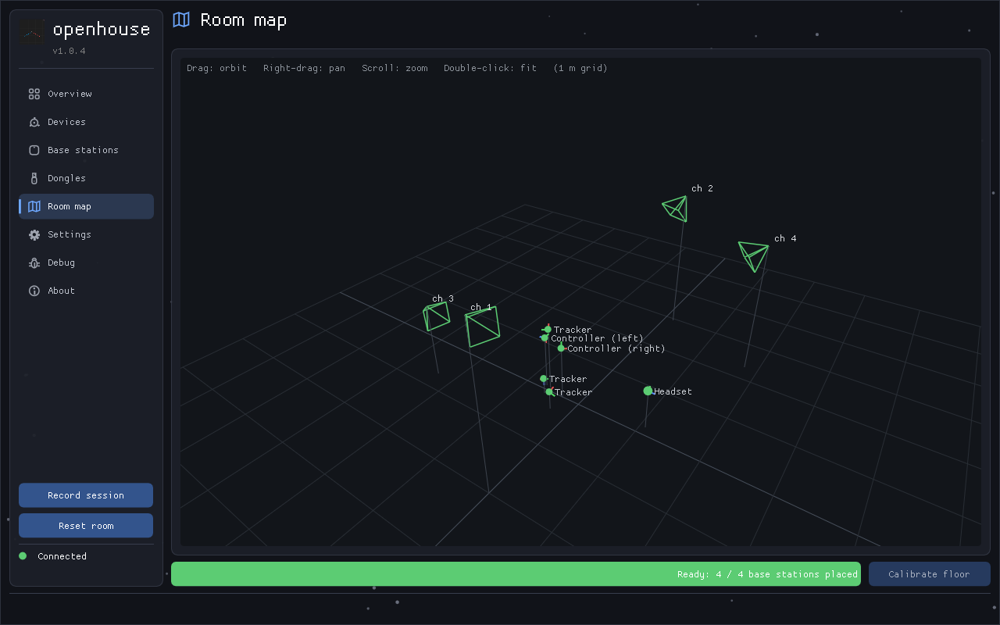
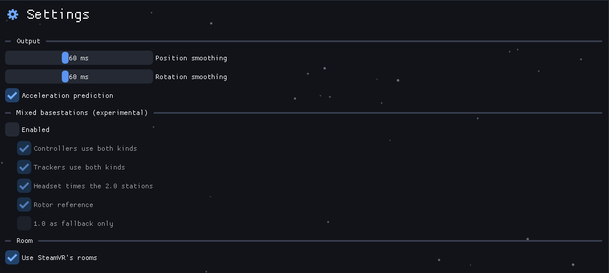
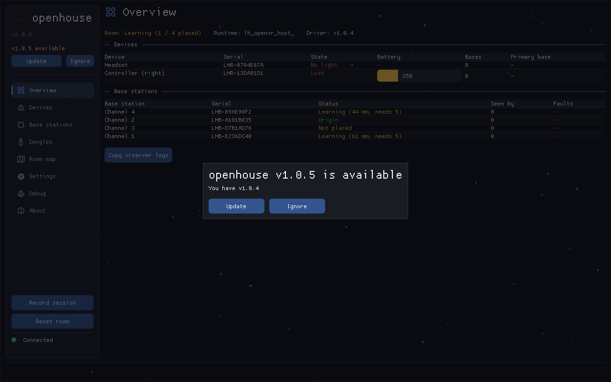
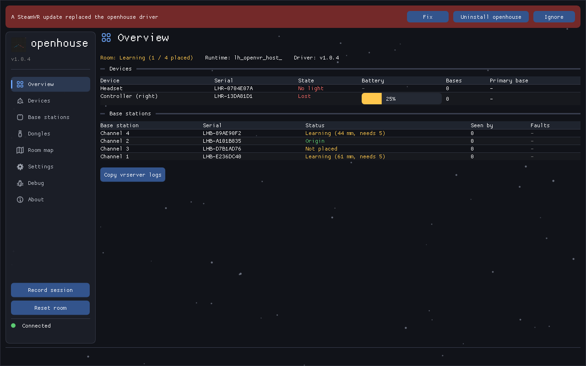

# openhouse-overlay and the apps

[Back to the README](../README.md)

`openhouse-overlay` is the main overlay/manager for openhouse. The installer adds it to SteamVR, so it starts with SteamVR and you'll find an openhouse button in the SteamVR dashboard. Under Monado/WiVRn (or without SteamVR running) you can open it as a normal window, it's in the package's `apps` folder.

- [Pages](#pages)
- [Buttons on every page](#buttons-on-every-page)
- [Updates and broken installs](#updates-and-broken-installs)
- [Other apps](#other-apps)

## Pages

### Overview

A base station is **learning** while openhouse is still working out where it is, **locked** once it's well learned (it then only moves if the base station itself gets bumped), and the **origin** is the one the room is built around.

### Devices
Details for each device: its state, battery, position and speed, and which base stations it sees (with how many sensors and sweeps). You can vibrate a device, power it off or disable it here. A disabled device is ignored by openhouse completely.

Trackers can also be **named** here (for example _Waist_, _Left foot_): **Rename tracker** asks for a name, which openhouse keeps by the tracker's hardware serial so it follows that tracker across reconnects and restarts, and **Clear name** goes back to the default label. In the SteamVR dashboard the name is typed on SteamVR's own keyboard; in the desktop window it's an ordinary text box. SteamVR itself keeps identifying the tracker by its serial.

### Base stations
Where each base station is, how well it's placed (uncertainty), its faults and which devices see it.

#### Channel management

Select a Lighthouse 2.0 station and use **Change channel** to move it to an
unused channel. **Automatically resolve channel conflicts** keeps one station
on its current channel and moves the others one at a time. The toggle starts
off each time you open the overlay.

OpenHouse pauses tracking and room learning from both stations on a shared
channel. Devices that can only see those stations lose optical tracking until
the conflict clears. Keep the station visible after the move so the driver can
confirm its new channel. If the room map is wrong, use **Reset room** after
giving the stations distinct channels.

Channel changes require a Bluetooth LE adapter and the optional Lighthouse BLE
library. Follow the [installation instructions](../ai/driver/lh2_channels.md)
to enable these controls.

### Dongles
Each dongle, the devices paired to it, and a button to put a single dongle into pairing mode. Doorman dongles show their slots too. For more information and per-slot pairing of Doorman dongles, use the [dongle manager](doorman.md#the-dongle-manager).

### Room map
A 3D view of the room, your base stations and your devices, along with how far the room learning is

Under Monado/WiVRn you can also set the floor level from here with **Calibrate floor**. Put your controllers on the floor and wait 7 seconds. **This is not needed for SteamVR, Room Setup already does this**

### Settings

- **Position / Rotation smoothing**: how long a tracking correction takes to show up, 60 ms by default. Lower means less delay, but small corrections can show up as tiny jumps. 0 turns it off
- **Acceleration prediction**: helps SteamVR predict where your controllers will be during fast motion. On by default
- **Mixed basestations**: using 1.0 and 2.0 base stations in one room. Experimental and off by default, see [Base stations](basestations.md#mixed-10-and-20-base-stations-experimental)
- **Use SteamVR's rooms**: keeps openhouse in step with SteamVR's own room files, so Room Setup isn't asked for on every start. See [Configuration](configuration.md#use-steamvrs-rooms)

They're saved to `settings.json` and apply while you play.

### Debug
Detailed information about the tracking and the driver's log. Mostly useful when something goes wrong.

### About
The overlay's and the driver's versions.

## Buttons on every page
- **Record session**: records a session for a bug report. See [Reporting a bug](../README.md#reporting-a-bug)
- **Reset room**: forgets the learned room and starts learning it again (you need to do Room Setup again if you've done it)
- **Copy vrserver logs** (on Overview): copies SteamVR's `vrserver.txt` to your clipboard, so you can paste it into a bug report or a message

## Updates and broken installs
When a new version is out, a popup shows up once when the overlay starts, and an "available" note with **Update** and **Ignore** stays at the top left. Update opens the changelog and installs the new version (SteamVR is closed while it installs).

When a SteamVR update replaced openhouse's driver, a red bar on top of every page offers **Fix**, **Uninstall openhouse** and **Ignore**, see [When a SteamVR update replaces openhouse](../README.md#when-a-steamvr-update-replaces-openhouse).

## Other apps
These are in the package's `apps` folder too.

- **`doorman-dongle-manager`** manages Doorman dongles: pairing, slots, radio statistics and firmware. See [Doorman](doorman.md#the-dongle-manager)
- **`openhouse-viewer`** shows the running driver's status and log in a window
- **`lhviz`** is a 3D viewer that runs its own tracking without SteamVR, mostly for development or testing. Needs `glfw` on Linux
- **`lhcapture`** and **`lhtool`** are command line tools for recordings, see [Development](development.md#tools)
